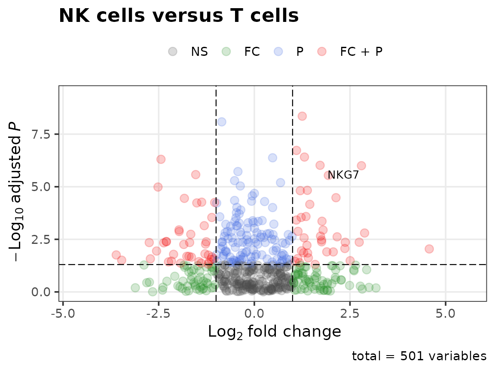
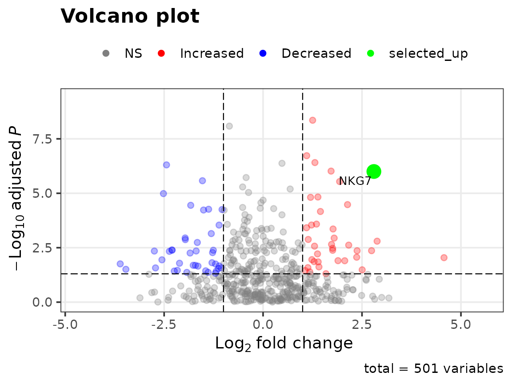
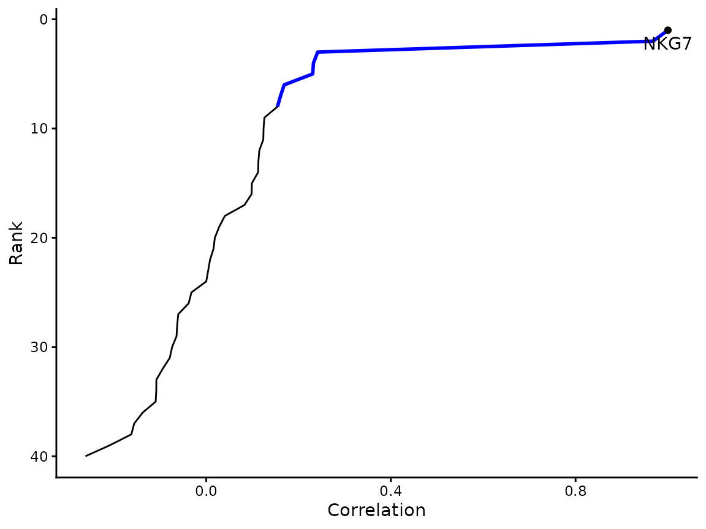

# Getting started with usefulfunctions

`usefulfunctions` collects the helpers I use repeatedly in single-cell,
bulk RNA-seq and cancer-genomics analyses. This vignette walks through
the functions that run without optional Bioconductor dependencies, using
simulated data. The functions that need Seurat, clusterProfiler, biomaRt
or TCGAbiolinks are described at the end.

## Volcano plots

[`volcano_plot()`](https://eomesodermin.github.io/r-utility-functions/reference/volcano_plot.md)
takes a differential-expression table with a log fold change and an
adjusted p-value, colours points by which cutoffs they pass, and labels
genes.

``` r

set.seed(1)
de <- data.frame(
  logFC = rnorm(500, sd = 1.2),
  FDR = runif(500)^3,
  row.names = paste0("gene", 1:500)
)
de["NKG7", ] <- c(2.8, 1e-6)

volcano_plot(de, fc_cutoff = 1, label_genes = "NKG7", title = "NK cells versus T cells")
```



Highlighting a gene of interest uses the point helpers, which return one
value per row:

``` r

volcano_plot(
  de,
  fc_cutoff = 1,
  label_genes = "NKG7",
  point_colours = colour_volcano_points(de, highlight.selected = TRUE, highlight.genes = "NKG7",
                                        logFC.cutoff = 1),
  alpha = alpha_volcano_points(de, "NKG7", baseline.alpha = 0.3),
  point_size = size_volcano_points(de, "NKG7", baseline.size = 2, highlight.size = 5)
)
```



## Gene-gene correlation in single cells

[`sc_correlation()`](https://eomesodermin.github.io/r-utility-functions/reference/sc_correlation.md)
correlates one gene against every other gene across cells and reports
the correlation, p-value and Benjamini-Hochberg FDR, sorted from most to
least correlated.

``` r

expr <- matrix(rnorm(40 * 60), nrow = 40,
               dimnames = list(c("NKG7", paste0("g", 1:39)), paste0("cell", 1:60)))
expr["g1", ] <- expr["NKG7", ] + rnorm(60, sd = 0.3)   # a co-expressed gene

cor_df <- sc_correlation(expr, goi = "NKG7", remove.quantile = 0, output.tables = NULL)
head(cor_df, 4)
#>   GeneID   Cor.val        P.val          FDR
#> 1   NKG7 1.0000000 0.000000e+00 0.000000e+00
#> 2     g1 0.9676582 2.187029e-36 4.374059e-35
#> 3     g5 0.2413651 6.319048e-02 5.089608e-01
#> 4    g35 0.2322416 7.416485e-02 5.089608e-01
```

``` r

plots <- plot_correlation(cor_df, output.dir = NULL, goi = "NKG7", top.n.val = 8)
plots$ranking
```



## Splitting samples by expression

[`stratify_by_expression()`](https://eomesodermin.github.io/r-utility-functions/reference/stratify_by_expression.md)
returns the samples in the top and bottom quantile for a gene, or for a
multi-gene signature scored as the mean z-score. It is the
stratification step used by
[`tcga_survival()`](https://eomesodermin.github.io/r-utility-functions/reference/tcga_survival.md).

``` r

bulk <- matrix(rexp(3 * 40), nrow = 3,
               dimnames = list(c("NKG7", "GZMB", "ACTB"), paste0("TCGA-AB-", sprintf("%04d", 1:40), "-01A")))
strata <- stratify_by_expression(bulk, c("NKG7", "GZMB"), quantile = 0.25)
lengths(strata[c("high", "low")])
#> high  low 
#>   10   10
```

## Small utilities

``` r

make_transparent(c("red", "navy"), percent = c(20, 60))
#> [1] "#FF0000CC" "#00008066"
get_batlow(5)
#> [1] "#001959" "#215F61" "#818231" "#F19D6B" "#F9CCF9"
moving_average(c(1, 3, 2, 8, 5, NA, 4), n = 3, centered = TRUE)
#> [1] 2.000000 2.000000 4.333333 5.000000 6.500000 4.500000 4.000000
standardize(rbind(c(1, 2, 3, 40), c(5, 5, 5, 5)))
#>           [,1]       [,2]      [,3]    [,4]
#> [1,] -1.011736 -0.3372454 0.3372454 25.2934
#> [2,]  0.000000  0.0000000 0.0000000  0.0000
```

[`standardize()`](https://eomesodermin.github.io/r-utility-functions/reference/standardize.md)
centres each row by its median and scales by its MAD, and leaves
constant rows at zero instead of producing `NaN`.

## Functions with optional dependencies

These check for their packages when called and give a clear message if
one is missing.

| Function | Needs | What it does |
|----|----|----|
| [`go_enrichment()`](https://eomesodermin.github.io/r-utility-functions/reference/go_enrichment.md) | clusterProfiler, org.Hs.eg.db or org.Mm.eg.db | GO over-representation of top-ranked genes, as a plot or `enrichResult` |
| [`convert_mouse_to_human()`](https://eomesodermin.github.io/r-utility-functions/reference/convert_genes.md), [`convert_human_to_mouse()`](https://eomesodermin.github.io/r-utility-functions/reference/convert_genes.md) | biomaRt, or the JAX report with `use.jax = TRUE` | Ortholog symbol conversion |
| [`umap_optimise()`](https://eomesodermin.github.io/r-utility-functions/reference/umap_optimise.md) | Seurat | Sweeps `min.dist` and `n.neighbors` and saves a PDF per setting |
| [`correlation_heatmaps()`](https://eomesodermin.github.io/r-utility-functions/reference/correlation_heatmaps.md) | Seurat | Heatmaps of the most positively and negatively correlated genes |
| [`basic_heatmap()`](https://eomesodermin.github.io/r-utility-functions/reference/basic_heatmap.md) | gplots | Clustered log2 heatmap |
| [`dendrogram_samples()`](https://eomesodermin.github.io/r-utility-functions/reference/dendrogram_samples.md) | factoextra (and ape for phylogeny layouts) | Sample dendrogram |
| [`tcga_survival()`](https://eomesodermin.github.io/r-utility-functions/reference/tcga_survival.md), [`download_tcga_rnaseq()`](https://eomesodermin.github.io/r-utility-functions/reference/download_tcga_rnaseq.md) | TCGAbiolinks | TCGA overall survival by gene or signature expression |

## Renamed functions

Earlier versions used dot.case names
([`makeTransparent()`](https://eomesodermin.github.io/r-utility-functions/reference/legacy_aliases.md),
[`GO.function()`](https://eomesodermin.github.io/r-utility-functions/reference/legacy_aliases.md),
[`TCGA.OS()`](https://eomesodermin.github.io/r-utility-functions/reference/legacy_aliases.md),
…). They still work, warn once per session, and forward to the
snake_case function. See
[`?legacy_aliases`](https://eomesodermin.github.io/r-utility-functions/reference/legacy_aliases.md)
for the full table.
